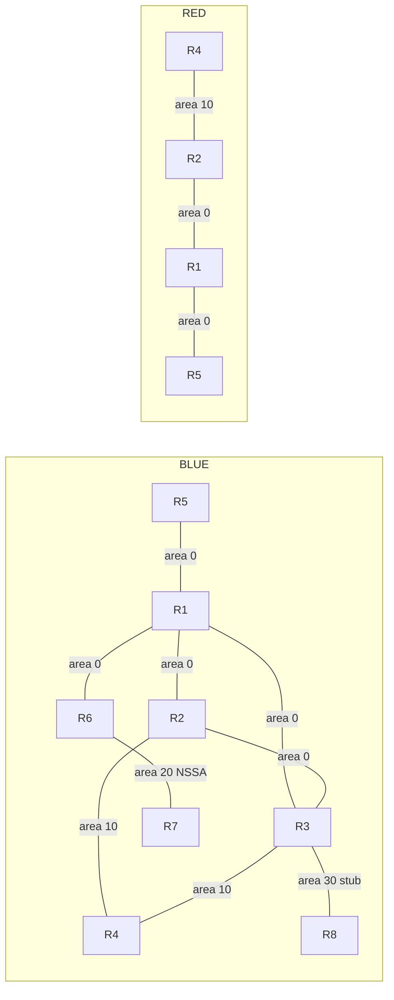

# Addressing and topology

Eight routers, twelve physical links: nine BLUE and three RED. No VLAN trunks, MPLS or route leaking. All interfaces are addressed in the starter. BLUE/RED VRFs and bindings are preprovisioned except Loopback900 on R1/R5, which starts global for Activity V1. OSPF is not configured.

BLUE uses process 10 and router IDs r.r.r.r; RED uses process 20 and IDs 20.20.20.r. RDs are 65000:10 (BLUE), 65000:20 (RED). IP addresses deliberately overlap across VRFs.

| VRF | Link | First interface (.1) | Second interface (.2) | Subnet | Area |
|---|---|---|---|---|---|
| BLUE | R1–R2 | R1 Ethernet0/0 | R2 Ethernet0/0 | 10.255.12.0/30 | 0 |
| BLUE | R1–R3 | R1 Ethernet0/1 | R3 Ethernet0/0 | 10.255.13.0/30 | 0 |
| BLUE | R2–R3 | R2 Ethernet0/1 | R3 Ethernet0/1 | 10.255.23.0/30 | 0 |
| BLUE | R2–R4 | R2 Ethernet0/2 | R4 Ethernet0/0 | 10.255.24.0/30 | 10 |
| BLUE | R3–R4 | R3 Ethernet0/2 | R4 Ethernet0/1 | 10.255.34.0/30 | 10 |
| BLUE | R1–R5 | R1 Ethernet0/2 | R5 Ethernet0/0 | 10.255.15.0/30 | 0 |
| BLUE | R1–R6 | R1 Ethernet0/3 | R6 Ethernet0/0 | 10.255.16.0/30 | 0 |
| BLUE | R6–R7 | R6 Ethernet0/1 | R7 Ethernet0/0 | 10.255.67.0/30 | 20 |
| BLUE | R3–R8 | R3 Ethernet0/3 | R8 Ethernet0/0 | 10.255.38.0/30 | 30 |
| RED | R1–R2 | R1 Ethernet1/0 | R2 Ethernet1/0 | 10.255.12.0/30 | 0 |
| RED | R1–R5 | R1 Ethernet1/1 | R5 Ethernet1/0 | 10.255.15.0/30 | 0 |
| RED | R2–R4 | R2 Ethernet1/1 | R4 Ethernet1/0 | 10.255.24.0/30 | 10 |

| Router | Interface | Address | Startup → final VRF | Target area / role |
|---|---|---|---|---|
| R1 | Loopback0 | 10.255.0.1/32 | BLUE → BLUE | 0 |
| R1 | Loopback1000 | 10.255.0.1/32 | RED → RED | 0 |
| R1 | Loopback900 | 198.18.0.1/32 | global → BLUE | 0 |
| R2 | Loopback0 | 10.255.0.2/32 | BLUE → BLUE | 0 |
| R2 | Loopback1000 | 10.255.0.2/32 | RED → RED | 0 |
| R3 | Loopback0 | 10.255.0.3/32 | BLUE → BLUE | 0 |
| R4 | Loopback0 | 10.255.0.4/32 | BLUE → BLUE | 10 |
| R4 | Loopback100 | 10.10.0.1/24 | BLUE → BLUE | 10 |
| R4 | Loopback101 | 10.10.1.1/24 | BLUE → BLUE | 10 |
| R4 | Loopback102 | 10.10.2.1/24 | BLUE → BLUE | 10 |
| R4 | Loopback103 | 10.10.3.1/24 | BLUE → BLUE | 10 |
| R4 | Loopback104 | 10.10.4.1/24 | BLUE → BLUE | 10 |
| R4 | Loopback105 | 10.10.5.1/24 | BLUE → BLUE | 10 |
| R4 | Loopback108 | 10.10.8.1/24 | BLUE → BLUE | 10 |
| R4 | Loopback350 | 10.10.250.1/24 | BLUE → BLUE | 10 |
| R4 | Loopback1000 | 10.255.0.4/32 | RED → RED | 10 |
| R4 | Loopback1100 | 10.10.0.1/24 | RED → RED | 10 |
| R4 | Loopback1101 | 10.10.1.1/24 | RED → RED | 10 |
| R4 | Loopback1102 | 10.10.2.1/24 | RED → RED | 10 |
| R4 | Loopback1103 | 10.10.3.1/24 | RED → RED | 10 |
| R5 | Loopback0 | 10.255.0.5/32 | BLUE → BLUE | 0 |
| R5 | Loopback100 | 172.20.16.1/24 | BLUE → BLUE | Redistribution only |
| R5 | Loopback101 | 172.20.17.1/24 | BLUE → BLUE | Redistribution only |
| R5 | Loopback102 | 172.20.18.1/24 | BLUE → BLUE | Redistribution only |
| R5 | Loopback103 | 172.20.19.1/24 | BLUE → BLUE | Redistribution only |
| R5 | Loopback104 | 172.20.99.1/24 | BLUE → BLUE | Redistribution only |
| R5 | Loopback1000 | 10.255.0.5/32 | RED → RED | 0 |
| R5 | Loopback1100 | 172.20.16.1/24 | RED → RED | Redistribution only |
| R5 | Loopback1101 | 172.20.17.1/24 | RED → RED | Redistribution only |
| R5 | Loopback1102 | 172.20.18.1/24 | RED → RED | Redistribution only |
| R5 | Loopback1103 | 172.20.19.1/24 | RED → RED | Redistribution only |
| R5 | Loopback1900 | 198.51.100.5/32 | RED → RED | 0 |
| R5 | Loopback900 | 198.18.0.5/32 | global → BLUE | 0 |
| R6 | Loopback0 | 10.255.0.6/32 | BLUE → BLUE | 0 |
| R7 | Loopback0 | 10.255.0.7/32 | BLUE → BLUE | 20 |
| R7 | Loopback100 | 172.21.32.1/24 | BLUE → BLUE | Redistribution only |
| R7 | Loopback101 | 172.21.33.1/24 | BLUE → BLUE | Redistribution only |
| R7 | Loopback102 | 172.21.34.1/24 | BLUE → BLUE | Redistribution only |
| R7 | Loopback103 | 172.21.35.1/24 | BLUE → BLUE | Redistribution only |
| R8 | Loopback0 | 10.255.0.8/32 | BLUE → BLUE | 30 |
| R8 | Loopback100 | 10.30.0.1/24 | BLUE → BLUE | 30 |

The two diagrams show logical VRF domains on the same physical routers, not sixteen devices.
